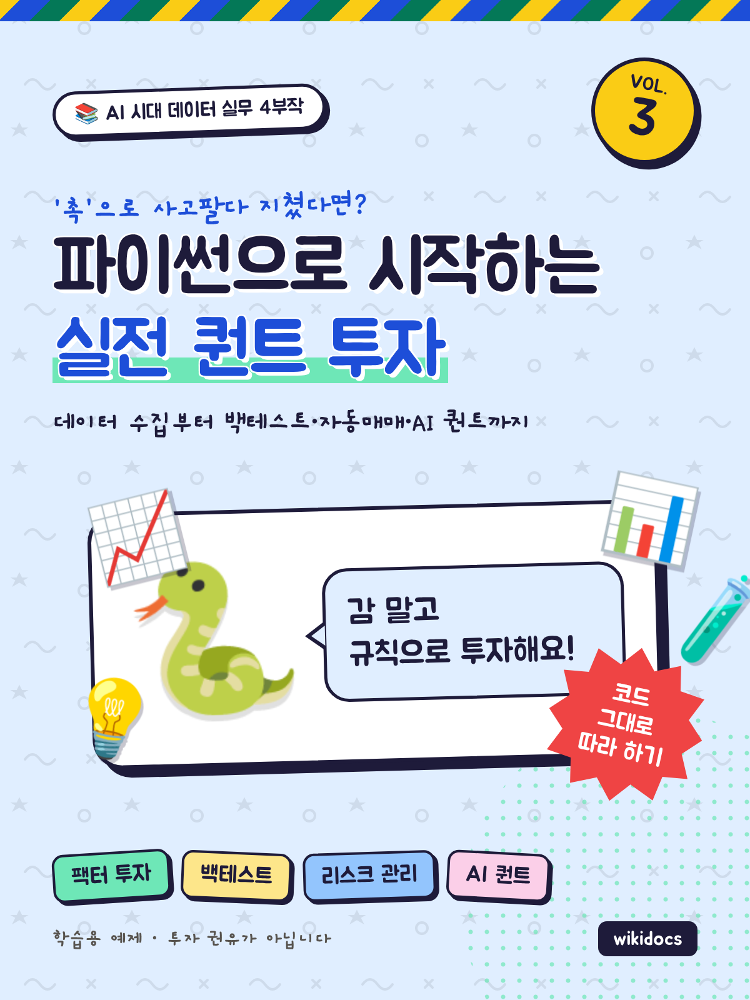

# 파이썬으로 시작하는 실전 퀀트 투자

**데이터 수집부터 백테스트·자동매매·AI 퀀트까지**

퀀트 투자의 기초 개념, 데이터 수집과 정제, 팩터와 전략, 백테스트, 리스크 관리, 자동매매, LLM을 활용한 AI 퀀트까지 실행 가능한 코드로 정리합니다. 본 책의 내용은 투자 권유가 아니며, 투자 판단과 책임은 독자에게 있습니다.

## 이런 분께 추천합니다

- 데이터로 투자하고 싶은 개인 투자자
- 파이썬 개발자

## 이 책의 구성

| 장 | 내용 |
|---|---|
| 01. 퀀트 기초 | 퀀트 투자가 무엇인지, 수익률과 위험을 어떻게 재는지, 분석 환경을 어떻게 만드는지 배웁니다. |
| 02. 데이터 수집·정제 | 주가·재무 데이터를 모으고, 결측치·수정주가·상장폐지 같은 함정을 처리합니다. |
| 03. 팩터 투자 | 가치·모멘텀·퀄리티·저변동성 팩터를 이해하고 직접 계산해 결합합니다. |
| 04. 전략 | 추세추종, 평균회귀, 페어 트레이딩, 자산배분 전략을 코드로 구현합니다. |
| 05. 백테스트와 편향 | 백테스트 엔진을 만들고, 결과를 속이는 편향과 과최적화를 피하는 법을 다룹니다. |
| 06. 포트폴리오·리스크 관리 | 비중 결정, 리밸런싱, 낙폭 관리로 전략을 오래 살아남게 만듭니다. |
| 07. 자동매매 | 증권사 API로 주문을 자동화하고 안전하게 운영하는 방법입니다. |
| 08. AI 퀀트 | LLM과 머신러닝을 퀀트 투자에 활용하는 방법을 다룹니다. |
| 09. 금융 지식그래프 | 기업·산업·공급망 관계를 그래프로 표현해 투자 아이디어로 연결합니다. |
| 90. 부록 | 코드 모음, 용어집, 참고자료를 모았습니다. |

## 「AI 시대 데이터 실무 4부작」 시리즈

시리즈 전체 소개: [AI 시대 데이터 실무 4부작](https://wikidocs.net/wiki/9013/)

- [AI 300% 활용법](https://wikidocs.net/book/22293)
- [가명정보 A to Z](https://wikidocs.net/book/22299)
- [LLM × 온톨로지 무엇을 해야할까?](https://wikidocs.net/book/22298)

## 저자

저자명
