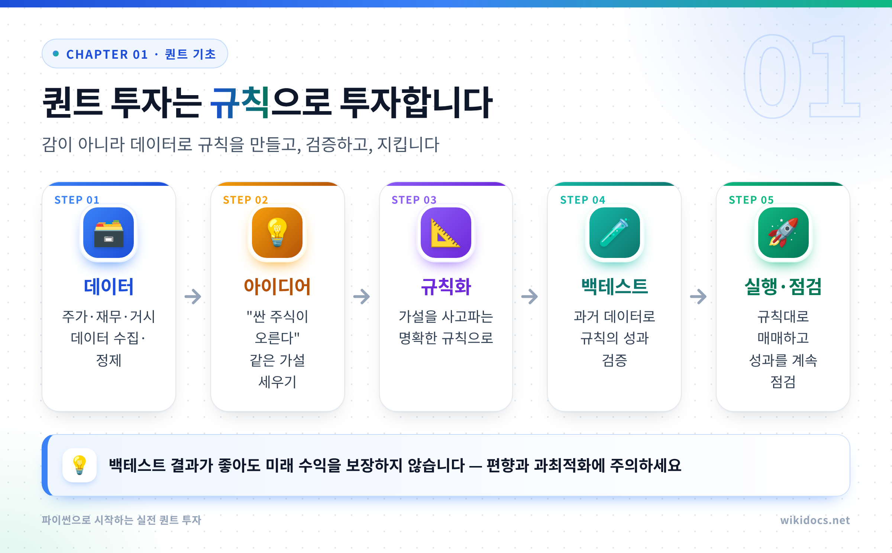

<!--
**상태**: 🔵 검토 중
**분류**: 01. 퀀트 기초
**태그**: #기초
**작성일**: 2026-11-22
-->
> 📅 **최종 확인**: 2026-11-22

퀀트(Quant) 투자는 **숫자와 규칙으로 투자하는 방법**입니다. "이 회사가 좋아 보여서"가 아니라 "PBR이 낮은 하위 20% 종목을 매월 같은 비중으로 산다"처럼, 누가 해도 같은 결과가 나오는 규칙을 만들고 지킵니다.

## 요약

- 퀀트 투자는 **데이터 → 가설 → 규칙 → 검증 → 실행**의 순서로 진행합니다.
- 가장 큰 장점은 **감정을 배제하고 일관되게** 투자할 수 있다는 점입니다.
- 가장 큰 위험은 **과거에만 잘 맞는 규칙**을 만드는 것입니다. 그래서 검증 방법이 핵심입니다.


## 퀀트 투자의 흐름



| 단계 | 하는 일 | 이 책의 장 |
|---|---|---|
| 데이터 | 주가·재무제표 등을 모으고 정리 | 02장 |
| 아이디어 | "싼 주식이 장기적으로 오른다" 같은 가설 | 03장 팩터, 04장 전략 |
| 규칙화 | 가설을 매수·매도 규칙으로 바꿈 | 04장 |
| 백테스트 | 과거 데이터로 규칙의 성과를 시험 | 05장 |
| 실행·점검 | 규칙대로 투자하고 성과를 계속 확인 | 06장, 07장 |

## 감에 의한 투자와 무엇이 다른가

| | 감에 의한 투자 | 퀀트 투자 |
|---|---|---|
| 판단 기준 | 뉴스, 느낌, 주변 의견 | 미리 정한 규칙 |
| 일관성 | 기분·시장 분위기에 따라 흔들림 | 같은 상황이면 같은 결정 |
| 검증 | 사후에 "그때 팔았어야 했는데" | 미리 과거 데이터로 시험 |
| 확장성 | 사람이 볼 수 있는 종목 수에 한계 | 수천 종목도 동시에 평가 |

## 예시: 간단한 규칙 하나

```text
[규칙 예시 — 학습용]
1. 매월 첫 거래일에
2. 전체 상장 종목 중 PBR이 낮은 순서로 30개를 고르고
3. 같은 금액씩 나눠 사서
4. 다음 달 첫 거래일까지 보유한 뒤 다시 1번부터 반복
```

이 규칙은 누가 실행해도 같은 종목을 고릅니다. 이렇게 규칙이 명확하면 **과거에 이 규칙대로 했다면 어땠을지** 컴퓨터로 시험할 수 있습니다. 이것이 백테스트입니다.

[[TIP("주의")]]

이 책의 모든 규칙과 코드는 **학습용 예시**입니다. 투자 권유가 아니며, 실제 투자 판단과 그 결과의 책임은 투자자 본인에게 있습니다. 과거 성과는 미래 수익을 보장하지 않습니다.

[[/TIP]]

## 퀀트 투자의 한계

- **과최적화**: 과거 데이터에 꼭 맞게 조건을 계속 바꾸면, 새로운 시장에서는 통하지 않습니다.
- **데이터 함정**: 상장폐지 종목을 빼먹거나, 그때는 몰랐던 정보를 쓰면 결과가 부풀려집니다. (05장)
- **규칙을 지키는 어려움**: 큰 손실 구간에서 규칙을 버리고 싶은 마음이 듭니다. 그래서 06장에서 버틸 수 있는 위험 수준을 미리 정합니다.

## 실무 체크포인트

- [ ] 투자 아이디어를 누가 해도 같은 결과가 나오는 규칙으로 적을 수 있는가
- [ ] 규칙을 실제로 쓰기 전에 과거 데이터로 시험할 계획이 있는가
- [ ] 감당할 수 있는 최대 손실 수준을 정했는가

## 관련 페이지

- 01-2. 수익률 계산
- 01-3. 위험 측정
- 📚 05-3. 생존편향·미래참조편향
