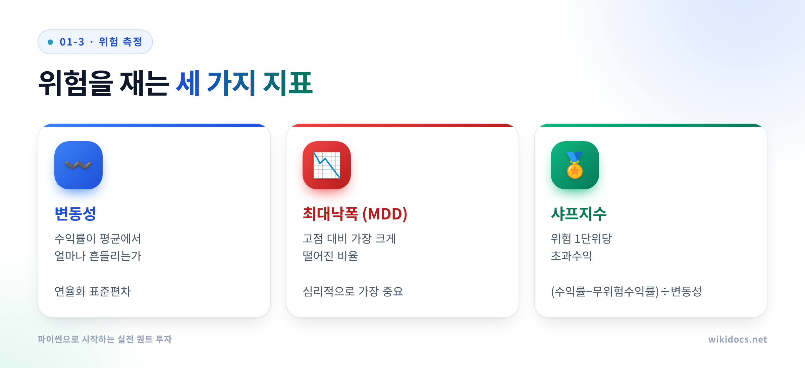

<!--
**상태**: 🔵 검토 중
**분류**: 01. 퀀트 기초
**태그**: #기초 #위험
**작성일**: 2026-11-22
-->
> 📅 **최종 확인**: 2026-11-22

수익률만 보고 전략을 고르면 위험합니다. 같은 10% 수익이라도 중간에 반 토막이 났다가 회복한 전략과 꾸준히 오른 전략은 전혀 다릅니다. 이 페이지에서는 위험을 재는 세 가지 핵심 지표를 계산합니다.

## 요약

- **변동성**: 수익률이 얼마나 흔들리는지 보여 줍니다.
- **최대낙폭(MDD)**: 최고점에서 가장 크게 떨어진 비율로, 실제로 버틸 수 있는지를 판단하는 데 중요합니다.
- **샤프지수**: 위험 1단위당 얼마의 초과수익을 냈는지 보여 주어, 전략끼리 비교할 때 씁니다.

## 개념



| 지표 | 공식 | 읽는 법 |
|---|---|---|
| 변동성 | 일간 수익률 표준편차 × √252 | 클수록 많이 흔들림 |
| 최대낙폭(MDD) | min(가격 ÷ 이전 최고가 − 1) | −50%면 최고점에서 반 토막 난 적이 있음 |
| 샤프지수 | (연수익률 − 무위험수익률) ÷ 변동성 | 클수록 위험 대비 성과가 좋음 |

[[TIP("핵심")]]

−50% 손실을 회복하려면 **+100%** 수익이 필요합니다. 낙폭이 커질수록 회복은 훨씬 어려워지므로, MDD는 수익률만큼 중요합니다.

[[/TIP]]

## 코드

전체 코드는 `code/02_risk.py`에 있습니다.

```python
import numpy as np
import pandas as pd
from sample_data import make_prices

prices = make_prices()
ret = prices.pct_change().dropna()

# 1) 연율화 변동성
vol = ret.std() * np.sqrt(252)

# 2) 최대낙폭(MDD)
drawdown = prices / prices.cummax() - 1
mdd = drawdown.min()

# 3) 샤프지수 (무위험수익률 연 3% 가정)
risk_free = 0.03
annual_return = (1 + ret.mean()) ** 252 - 1
sharpe = (annual_return - risk_free) / vol

print(pd.DataFrame({"연수익률": annual_return, "변동성": vol,
                    "MDD": mdd, "샤프지수": sharpe}).round(3))
```

## 실행 결과

```text
    연수익률    변동성    MDD   샤프지수
A -0.030  0.247 -0.385 -0.243
B  0.080  0.152 -0.171  0.330
C -0.389  0.393 -0.852 -1.065
```

## 해석과 주의점

- 종목 B는 변동성(15.2%)과 MDD(−17.1%)가 가장 낮고, 샤프지수(0.33)는 유일하게 양수입니다. 위험 대비 성과가 가장 좋습니다.
- 종목 C는 최고점 대비 **85% 넘게** 떨어진 적이 있습니다. 이런 낙폭을 실제로 견디기는 거의 불가능합니다.
- 여기서 연수익률은 일간 평균을 연율화한 값이라 01-2의 CAGR과 조금 다릅니다. 샤프지수는 계산 방식(일간 평균 연율화, 무위험수익률 가정)에 따라 값이 달라지므로, 전략끼리 비교할 때는 **같은 방식**으로 계산해야 합니다.
- 모든 값은 가상 데이터 결과이며 투자 판단의 근거가 아닙니다.

## 실무 체크포인트

- [ ] 수익률과 함께 변동성·MDD를 확인했는가
- [ ] 내가 견딜 수 있는 MDD 한도를 정했는가
- [ ] 전략 비교 시 샤프지수를 같은 방식으로 계산했는가

## 관련 페이지

- 01-2. 수익률 계산
- 📚 06-3. 낙폭 관리와 포지션 사이징
