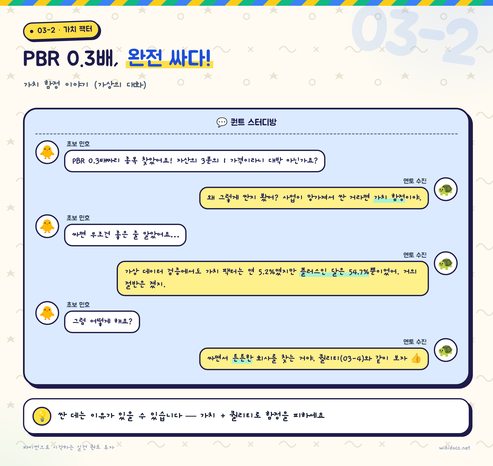

<!--
**상태**: 🔵 검토 중
**분류**: 03. 팩터 투자
**태그**: #팩터
**작성일**: 2026-11-22
-->
> 📅 **최종 확인**: 2026-11-25

**가치 팩터**는 "기업 가치에 비해 싸게 거래되는 주식"을 고릅니다. 가장 많이 쓰는 지표는 PBR(주가순자산비율)과 PER(주가수익비율)입니다.

## 요약

- PBR = 시가총액 ÷ 자본총계, PER = 시가총액 ÷ 당기순이익. **낮을수록** 가치 점수가 높습니다.
- PBR은 한쪽으로 치우친 분포라 **로그를 씌운 뒤** z-점수로 바꿉니다.
- 가상 데이터 검증: 상위-하위 차이 연 5.2%, 플러스인 달 54.7%.



## 계산

```python
import numpy as np
value = zscore(-np.log(fund["PBR"]))   # 마이너스: PBR이 낮을수록 점수가 높게
```

| 지표 | 장점 | 주의할 점 |
|---|---|---|
| PBR | 적자 기업도 계산 가능 | 무형자산이 큰 기업(소프트웨어 등)은 늘 비싸 보임 |
| PER | 이익 기준이라 직관적 | 적자면 계산 불가, 일회성 이익에 흔들림 |

## 검증 결과 (03-6의 전체 실행 결과 중 가치 행)

```text
      월평균 차이(상위-하위)    연환산  플러스인 달 비율  변동성(연)  위험대비(차이/변동성)
가치            0.004  0.052      0.547   0.083         0.634
```

- 싼 주식 그룹이 비싼 주식 그룹보다 연 5.2% 높았지만, 플러스인 달은 **54.7%**뿐입니다. 거의 절반의 달은 오히려 졌습니다.
- 가치 팩터는 수년간 부진하는 경우가 많아, 혼자 쓰면 버티기 어렵습니다 (03-6 멀티팩터).

[[TIP("가치 함정")]]

PBR이 낮은 이유가 **사업이 망가져서**일 수도 있습니다. 싸기만 한 종목을 피하려면 퀄리티(03-4)와 함께 보세요.

[[/TIP]]

> 모든 수치는 `code/sample_data.py`의 **가상 데이터** 결과입니다. 가상 데이터는 저PBR·고ROE·저변동성 종목에 작은 초과수익을 주도록 **가정해서 만든 것**이므로, 실제 시장에서 같은 결과가 나온다는 뜻이 아닙니다. 과거 성과는 미래 수익을 보장하지 않습니다.

## 실무 체크포인트

- [ ] PBR·PER 계산에 공시 접수일 이후의 재무 숫자를 썼는가
- [ ] 적자·자본잠식 기업 처리 규칙을 정했는가
- [ ] 가치 함정을 피하는 보완 지표가 있는가

## 관련 페이지

- 03-1. 팩터란 무엇인가
- 03-3. 모멘텀 팩터
- 03-4. 퀄리티 팩터
- 03-5. 저변동성 팩터
- 03-6. 멀티팩터 결합
