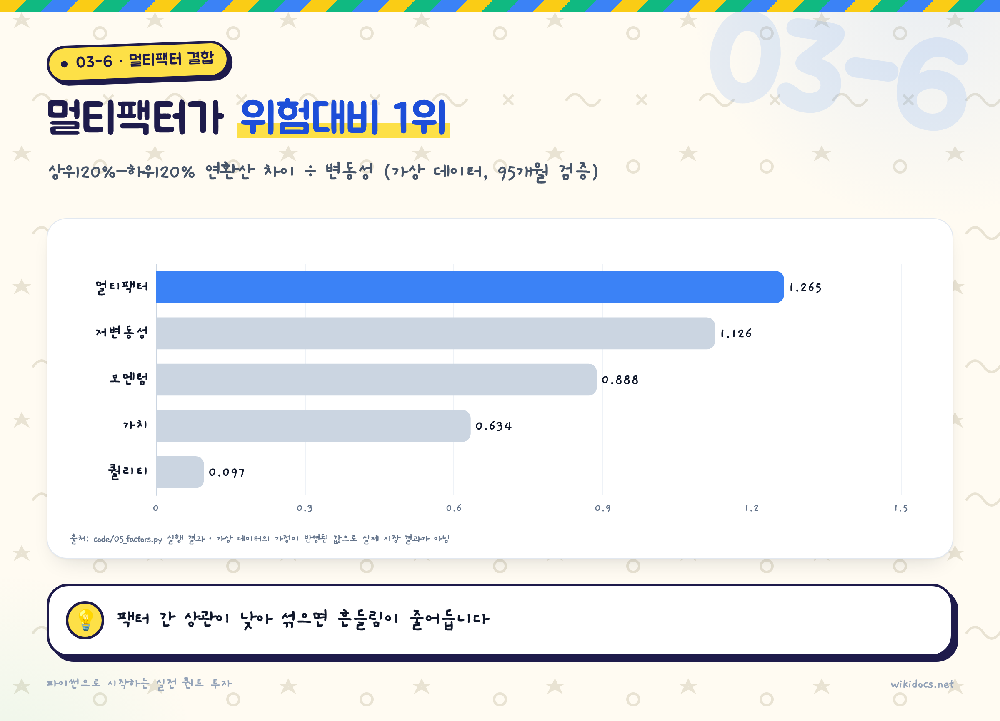

<!--
**상태**: 🔵 검토 중
**분류**: 03. 팩터 투자
**태그**: #팩터
**작성일**: 2026-11-22
-->
> 📅 **최종 확인**: 2026-11-25

팩터 하나는 몇 년씩 부진할 수 있습니다. 성격이 다른 팩터를 **섞으면** 한 팩터가 쉴 때 다른 팩터가 메워 주어 성과가 더 꾸준해집니다. 이 페이지에서 네 팩터를 계산하고 결합해 검증합니다.

## 요약

- 가장 간단한 결합은 **z-점수의 평균**입니다(같은 무게).
- 검증 결과 멀티팩터의 위험대비 성과(1.265)가 어느 단일 팩터보다 높았습니다.
- 이유는 팩터 간 **상관계수가 낮기** 때문입니다(−0.16 ~ 0.09).



## 코드

전체 코드는 `code/05_factors.py`에 있습니다.

```python
"""03장. 팩터 계산과 검증 — 가치·모멘텀·퀄리티·저변동성·멀티팩터 (가상 데이터)

매달 말 팩터 점수로 종목을 5개 그룹(분위)으로 나누고, 다음 달 수익률을 비교합니다.
"""
import numpy as np
import pandas as pd
from sample_data import make_universe

prices, fund = make_universe(n=200, months=120)
monthly = prices.pct_change()

def zscore(s: pd.Series) -> pd.Series:
    return (s - s.mean()) / s.std()

def factor_scores(t) -> pd.DataFrame:
    """t 시점까지의 정보만으로 점수 계산 (미래 정보 사용 금지)"""
    p = prices.loc[:t]
    f = pd.DataFrame(index=prices.columns)
    f["가치"] = zscore(-np.log(fund["PBR"]))                          # PBR 낮을수록 ↑
    f["모멘텀"] = zscore(p.iloc[-2] / p.iloc[-13] - 1)                 # 12-1개월 수익률
    f["퀄리티"] = zscore(zscore(fund["ROE"]) - zscore(fund["부채비율"]))  # ROE↑ 부채↓
    f["저변동성"] = zscore(-monthly.loc[:t].tail(24).std())             # 24개월 변동성 ↓
    f["멀티팩터"] = zscore(f[["가치", "모멘텀", "퀄리티", "저변동성"]].mean(axis=1))
    return f

if __name__ == "__main__":
    last = factor_scores(prices.index[-1])
    print("마지막 달 팩터 점수 (멀티팩터 상위 5종목)")
    print(last.sort_values("멀티팩터", ascending=False).head(5).round(2), "\n")

    spreads = {c: [] for c in last.columns}
    for i in range(24, len(prices) - 1):                  # 24개월 이후부터 매달 리밸런싱
        t, nxt = prices.index[i], prices.index[i + 1]
        f, fwd = factor_scores(t), monthly.loc[nxt]
        for c in f.columns:
            q = pd.qcut(f[c], 5, labels=False)
            spreads[c].append(fwd[q == 4].mean() - fwd[q == 0].mean())
    s = pd.DataFrame(spreads)
    out = pd.DataFrame({
        "월평균 차이(상위-하위)": s.mean(),
        "연환산": s.mean() * 12,
        "플러스인 달 비율": (s > 0).mean(),
        "변동성(연)": s.std() * np.sqrt(12),
    })
    out["위험대비(차이/변동성)"] = out["연환산"] / out["변동성(연)"]
    print(f"검증 기간: {len(s)}개월")
    print(out.round(3))
    print("\n팩터 점수 간 상관계수 (마지막 달)")
    print(last.drop(columns="멀티팩터").corr().round(2))
```

## 실행 결과

검증 방법: 매달 말 팩터 점수로 200개 종목을 5개 그룹으로 나누고, **다음 달** 수익률을 상위 20%와 하위 20% 사이에서 비교합니다(95개월).

```text
마지막 달 팩터 점수 (멀티팩터 상위 5종목)
        가치   모멘텀   퀄리티  저변동성  멀티팩터
S21   1.94 -0.48  2.06  1.15  2.39
S146  1.30  0.31  1.06  1.25  2.01
S99   1.78 -0.23  0.99  1.36  1.99
S22   0.12  1.13  1.13  1.31  1.88
S167  1.89  0.76  1.23 -0.31  1.82 

검증 기간: 95개월
      월평균 차이(상위-하위)    연환산  플러스인 달 비율  변동성(연)  위험대비(차이/변동성)
가치            0.004  0.052      0.547   0.083         0.634
모멘텀           0.007  0.081      0.642   0.091         0.888
퀄리티           0.001  0.008      0.484   0.082         0.097
저변동성          0.008  0.096      0.642   0.085         1.126
멀티팩터          0.008  0.092      0.642   0.073         1.265

팩터 점수 간 상관계수 (마지막 달)
        가치   모멘텀   퀄리티  저변동성
가치    1.00  0.03 -0.04  0.09
모멘텀   0.03  1.00 -0.07 -0.16
퀄리티  -0.04 -0.07  1.00  0.06
저변동성  0.09 -0.16  0.06  1.00
```

## 해석

- **멀티팩터**는 연환산 차이(9.2%)가 저변동성(9.6%)보다 조금 낮지만, 변동성이 가장 낮아(7.3%) **위험대비 1.265**로 1위입니다.
- 팩터 간 상관계수가 0에 가까워, 서로 다른 시기에 효과를 냅니다. 이것이 결합의 힘입니다.
- 결합 방법은 평균 외에도 **순위 평균**, 팩터별 위험을 맞추는 **위험 균형** 등이 있습니다. 머신러닝으로 가중치를 배우는 방법은 08-3에서 다룹니다.

## 결합 방법 비교

| 방법 | 방식 | 장점 | 단점 |
|---|---|---|---|
| z-점수 평균 | 팩터 점수를 같은 무게로 평균 | 단순, 과최적화 적음 | 약한 팩터도 같은 무게 |
| 순위 평균 | 팩터별 순위를 평균 | 이상치에 강함 | 정보 일부 손실 |
| 가중 결합 | 과거 성과로 가중치 | 강한 팩터에 집중 | 과최적화 위험 (05-4) |

> 모든 수치는 `code/sample_data.py`의 **가상 데이터** 결과입니다. 가상 데이터는 저PBR·고ROE·저변동성 종목에 작은 초과수익을 주도록 **가정해서 만든 것**이므로, 실제 시장에서 같은 결과가 나온다는 뜻이 아닙니다. 과거 성과는 미래 수익을 보장하지 않습니다.

## 실무 체크포인트

- [ ] 팩터를 결합하기 전에 상관계수를 확인했는가
- [ ] 결합 가중치를 과거 성과에 과하게 맞추지 않았는가
- [ ] 거래비용 차감 후에도 성과가 남는지 확인했는가 (05-2)

## 관련 페이지

- 03-1. 팩터란 무엇인가
- 03-2. 가치 팩터
- 03-3. 모멘텀 팩터
- 03-4. 퀄리티 팩터
- 03-5. 저변동성 팩터
