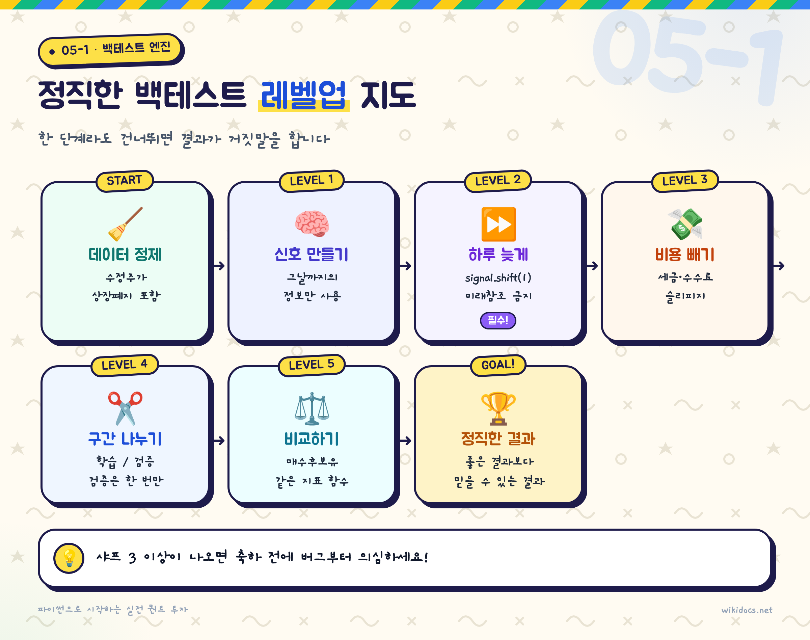

<!--
**상태**: 🔵 검토 중
**분류**: 05. 백테스트와 편향
**태그**: #백테스트
**작성일**: 2026-11-22
-->
> 📅 **최종 확인**: 2026-11-25

백테스트는 "과거에 이 규칙대로 했다면 어땠을까"를 계산하는 도구입니다. 이 페이지에서는 **신호 → 다음 날 포지션 → 비용 차감 → 성과 지표**까지 이어지는 간단한 엔진을 직접 만듭니다. 이 엔진은 05장의 다른 예제에서도 씁니다.

## 요약

- 엔진의 핵심은 세 가지: **신호를 하루 늦게 적용**, **비중 변화만큼 비용 차감**, **같은 방식으로 지표 계산**.
- 결과에는 비용 전·후와 '매수 후 보유'를 항상 함께 보여 줍니다.
- 연간 회전율(비중을 몇 번 바꿨나)을 함께 보면 비용 영향을 예상할 수 있습니다.



## 엔진 구조

```text
가격 ──► 수익률
신호 ──► shift(1) ──► 포지션 ──► 포지션 × 수익률 = 비용 전 수익
                         │
                         └► |포지션 변화| × 비용(bp) = 비용
                                       비용 전 수익 − 비용 = 비용 후 수익 ──► 성과 지표
```

## 코드

전체 코드는 `code/10_backtest_engine.py`에 있습니다.

```python
"""05-1. 간단한 백테스트 엔진 — 신호 → 다음날 포지션 → 비용 차감 → 성과 지표"""
import numpy as np
import pandas as pd
from sample_data import make_prices


def backtest(price: pd.Series, signal: pd.Series, cost_bps: float = 0.0) -> pd.DataFrame:
    """signal(0~1)을 '다음 날' 비중으로 사용. cost_bps: 매매금액 대비 편도 비용(bp)"""
    ret = price.pct_change().fillna(0)
    pos = signal.shift(1).fillna(0)                 # 미래참조 방지: 하루 늦게 적용
    turnover = pos.diff().abs().fillna(pos.abs())   # 비중 변화량 = 매매금액 비율
    cost = turnover * cost_bps / 10_000
    net = pos * ret - cost
    return pd.DataFrame({"pos": pos, "gross": pos * ret, "cost": cost, "net": net})


def report(r: pd.Series) -> dict:
    eq = (1 + r).cumprod()
    yrs = len(r) / 252
    vol = r.std() * np.sqrt(252)
    cagr = eq.iloc[-1] ** (1 / yrs) - 1
    return {"CAGR": cagr, "변동성": vol, "샤프(무위험0)": cagr / vol if vol else np.nan,
            "MDD": (eq / eq.cummax() - 1).min()}


if __name__ == "__main__":
    price = make_prices()["A"]
    signal = (price.rolling(20).mean() > price.rolling(60).mean()).astype(float)
    bt = backtest(price, signal, cost_bps=15)
    print("엔진 출력 (앞 3행)\n", bt.dropna().iloc[60:63].round(5), "\n")
    print(pd.DataFrame({"비용 전": report(bt["gross"]), "비용 후(15bp)": report(bt["net"]),
                        "매수후보유": report(price.pct_change().fillna(0))}).T.round(3))
    print("\n연간 회전율(배):", round(bt["pos"].diff().abs().sum() / (len(bt) / 252), 1))
```

## 실행 결과

```text
엔진 출력 (앞 3행)
             pos    gross    cost      net
2023-03-27  1.0 -0.02580  0.0015 -0.02730
2023-03-28  1.0 -0.00490  0.0000 -0.00490
2023-03-29  1.0  0.00303  0.0000  0.00303 

             CAGR    변동성  샤프(무위험0)    MDD
비용 전       -0.099  0.152    -0.648 -0.334
비용 후(15bp) -0.106  0.152    -0.694 -0.343
매수후보유      -0.059  0.247    -0.239 -0.385

연간 회전율(배): 5.3
```

## 해석

- 첫 매수일(2023-03-27)에 비중이 0→1로 바뀌어 **0.0015(15bp)**의 비용이 빠졌습니다.
- 연간 회전율이 5.3배라 비용 15bp를 넣으면 CAGR이 −9.9% → −10.6%로 더 나빠졌습니다.
- 이 가상 종목에서는 이동평균 전략이 매수 후 보유보다 수익이 낮았지만 MDD는 작았습니다. **좋은 엔진은 '좋은 결과'가 아니라 '정직한 결과'를 보여 줍니다.**

[[TIP("엔진을 쓰기 전 점검")]]

1. 신호를 하루 늦게 쓰는가 (`shift(1)`)
2. 비용이 들어갔는가
3. 매수 후 보유와 비교하는가
4. 같은 함수로 모든 전략의 지표를 계산하는가

[[/TIP]]

> 모든 수치는 가상 데이터로 계산한 결과이며 투자 권유가 아닙니다. 과거 성과는 미래 수익을 보장하지 않습니다.

## 실무 체크포인트

- [ ] 신호와 수익률의 날짜가 하루 어긋나 있는가
- [ ] 비용을 매매금액 기준으로 뺐는가
- [ ] 모든 전략을 같은 지표 함수로 비교하는가

## 관련 페이지

- 05-2. 거래비용과 슬리피지
- 05-3. 생존편향·미래참조편향
- 05-4. 과최적화와 검증 방법
