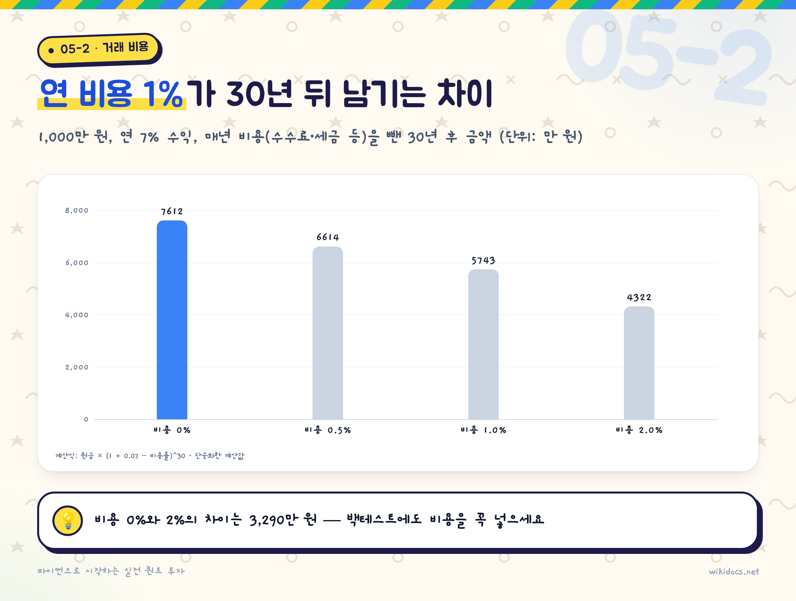
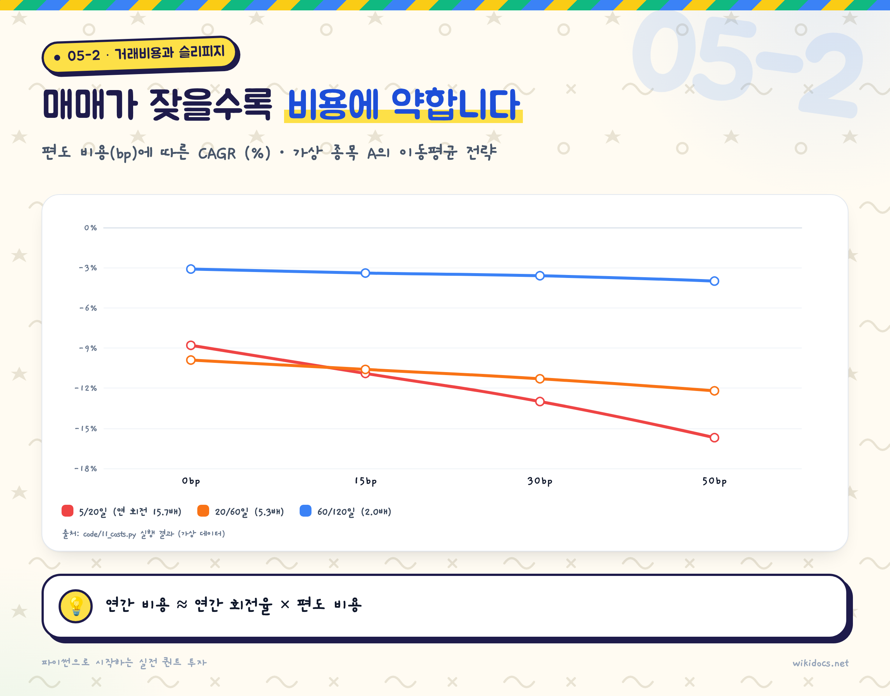
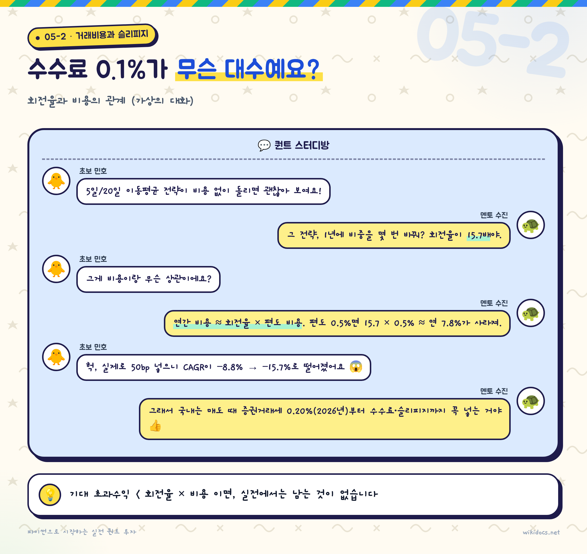

<!--
**상태**: 🔵 검토 중
**분류**: 05. 백테스트와 편향
**태그**: #백테스트
**작성일**: 2026-11-22
-->
> 📅 **최종 확인**: 2026-11-25

백테스트에서 좋던 전략이 실전에서 무너지는 가장 흔한 이유는 **거래비용**입니다. 수수료·세금뿐 아니라, 원하는 가격에 사지 못해 생기는 **슬리피지**까지 넣어야 합니다.

## 요약

- 국내 주식 매도 시 증권거래세는 2026년 기준 코스피·코스닥 모두 **0.20%**입니다(코스피는 거래세 0.05% + 농어촌특별세 0.15%).
- 비용 = 수수료(증권사별) + 세금(매도 시) + 슬리피지(호가 차이·체결 지연).
- 가상 데이터 실험: 매매가 잦은 5/20일 전략은 비용 50bp에서 CAGR이 −8.8% → −15.7%로 떨어졌습니다.







## 비용 구성 (국내 주식)

| 항목 | 크기 (예) | 언제 |
|---|---|---|
| 증권거래세 | 0.20% (2026년, 코스피는 농어촌특별세 포함) | 매도할 때 |
| 위탁수수료 | 증권사·채널별로 다름 | 매수·매도 모두 |
| 슬리피지 | 종목 유동성에 따라 다름 (소형주일수록 큼) | 매수·매도 모두 |

> 세율은 세법 개정으로 바뀝니다. 실제 적용 세율은 국세청·증권사 안내로 확인하세요.

## 코드: 매매 빈도와 비용의 관계

전체 코드는 `code/11_costs.py`에 있습니다.

```python
"""05-2. 거래비용과 슬리피지 — 같은 전략도 비용과 매매 빈도에 따라 결과가 바뀐다"""
import pandas as pd
from sample_data import make_prices
from importlib import import_module

eng = import_module("10_backtest_engine")
price = make_prices()["A"]
rows = []
for fast, slow in [(5, 20), (20, 60), (60, 120)]:
    sig = (price.rolling(fast).mean() > price.rolling(slow).mean()).astype(float)
    for bps in [0, 15, 30, 50]:
        bt = eng.backtest(price, sig, cost_bps=bps)
        rows.append({"전략": f"{fast}/{slow}일", "편도비용(bp)": bps,
                     "연회전율": bt["pos"].diff().abs().sum() / 3,
                     "CAGR": eng.report(bt["net"])["CAGR"]})
t = pd.DataFrame(rows).pivot(index="전략", columns="편도비용(bp)", values="CAGR")
t.insert(0, "연회전율(배)", pd.DataFrame(rows).groupby("전략")["연회전율"].first().round(1))
print("비용별 CAGR (가상 데이터)")
print(t.round(3))
```

## 실행 결과

```text
비용별 CAGR (가상 데이터)
편도비용(bp)  연회전율(배)      0     15     30     50
전략                                           
20/60일        5.3 -0.099 -0.106 -0.113 -0.122
5/20일        15.7 -0.088 -0.109 -0.130 -0.157
60/120일       2.0 -0.031 -0.034 -0.036 -0.040
```

## 해석

- 같은 이동평균 전략이라도 **5/20일**(연 회전율 15.7배)은 비용이 커질수록 급격히 나빠집니다.
- **60/120일**(연 2.0배)은 비용 50bp에서도 CAGR이 −3.1% → −4.0%로 영향이 작습니다.
- 편도 비용 50bp(0.5%)는 세금·수수료·슬리피지를 합치면 소형주에서 충분히 나올 수 있는 크기입니다.

[[TIP("어림 계산")]]

**연간 비용 ≈ 연간 회전율 × 편도 비용**입니다. 회전율 15배 × 0.3% = 연 4.5%가 비용으로 사라집니다. 전략의 기대 초과수익이 이보다 작다면 실전에서는 남는 것이 없습니다.

[[/TIP]]

> 모든 수치는 가상 데이터로 계산한 결과이며 투자 권유가 아닙니다. 과거 성과는 미래 수익을 보장하지 않습니다.

## 실무 체크포인트

- [ ] 세금·수수료·슬리피지를 모두 넣었는가
- [ ] 회전율과 비용을 곱해 연간 비용을 어림했는가
- [ ] 비용을 여러 수준으로 바꿔 민감도를 봤는가

## 근거·출처

| 구분 | 출처 | 비고 |
|---|---|---|
| 보도 | [내년부터 배당소득 분리과세 실시…증권거래세 0.05%p 상향 (다음뉴스)](https://v.daum.net/v/20251231105400803) | 2026년 증권거래세 |
| 보도 | [증권거래세 인상에 개미 부담 확대 (이코노미스트)](https://economist.co.kr/article/view/ecn202512220061) | 코스피 0.05% + 농특세 0.15% |

## 관련 페이지

- 05-1. 간단한 백테스트 엔진 만들기
- 05-3. 생존편향·미래참조편향
- 05-4. 과최적화와 검증 방법
