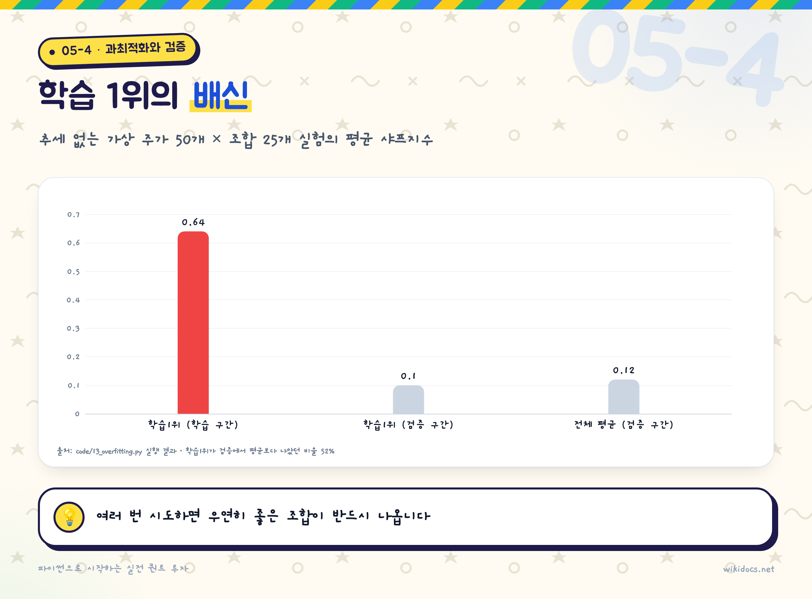

<!--
**상태**: 🔵 검토 중
**분류**: 05. 백테스트와 편향
**태그**: #백테스트 #검증
**작성일**: 2026-11-22
-->
> 📅 **최종 확인**: 2026-11-25

파라미터를 이것저것 바꿔 보다 보면 과거 데이터에 **딱 맞는** 조합을 찾게 됩니다. 하지만 그 조합은 우연에 맞춘 것일 가능성이 큽니다. 이 페이지에서는 **진짜 우위가 없는 데이터**로 이 함정을 직접 확인합니다.

## 요약

- 추세가 없는 가상 주가 50개 × 이동평균 조합 25개로 실험합니다.
- 학습 구간 1위 조합의 샤프 **0.64**가 검증 구간에서는 **0.10**으로 떨어졌고, 전체 평균(0.12)과 다르지 않았습니다.
- 학습 1위가 검증에서 평균보다 나을 확률은 **52%**, 사실상 동전 던지기입니다.





## 코드

전체 코드는 `code/13_overfitting.py`에 있습니다.

```python
"""05-4. 과최적화와 검증 — 학습 구간 최고 파라미터는 검증 구간에서도 좋을까?

추세가 없는 가상 주가(무작위 보행) 50개로 같은 실험을 반복합니다.
진짜 우위가 없는 데이터에서도 '학습 1위' 조합은 늘 좋아 보입니다.
"""
import numpy as np
import pandas as pd
from sample_data import make_prices
from importlib import import_module

eng = import_module("10_backtest_engine")
grid = [(f, s) for f in [5, 10, 20, 30, 40] for s in [60, 90, 120, 150, 200]]
rows = []
for seed in range(50):
    price = make_prices(days=1260, seed=100 + seed)["B"]
    split = price.index[756]                                # 앞 3년 학습, 뒤 2년 검증
    res = []
    for fast, slow in grid:
        sig = (price.rolling(fast).mean() > price.rolling(slow).mean()).astype(float)
        net = eng.backtest(price, sig, cost_bps=15)["net"]
        res.append((eng.report(net[:split])["샤프(무위험0)"], eng.report(net[split:])["샤프(무위험0)"]))
    res = np.array(res)
    best = res[:, 0].argmax()
    rows.append({"학습1위_학습샤프": res[best, 0], "학습1위_검증샤프": res[best, 1],
                 "전체평균_검증샤프": res[:, 1].mean()})
r = pd.DataFrame(rows)
print(f"반복 {len(r)}회 · 파라미터 조합 {len(grid)}개씩")
print(r.mean().round(2).to_string())
print(f"\n학습1위가 검증에서 전체 평균보다 나았던 비율: {(r['학습1위_검증샤프'] > r['전체평균_검증샤프']).mean():.0%}")
```

## 실행 결과

```text
반복 50회 · 파라미터 조합 25개씩
학습1위_학습샤프    0.64
학습1위_검증샤프    0.10
전체평균_검증샤프    0.12

학습1위가 검증에서 전체 평균보다 나았던 비율: 52%
```

## 해석

- 진짜 규칙성이 없는 데이터에서도 25개 중 가장 좋은 조합은 늘 그럴듯해 보입니다(샤프 0.64).
- 그러나 검증 구간에서는 아무 조합이나 고른 것과 같았습니다. **학습 성과가 좋은 이유가 '실력'이 아니라 '여러 번 시도한 덕'**이었기 때문입니다.

## 과최적화를 줄이는 방법

| 방법 | 내용 |
|---|---|
| 검증 구간 분리 | 학습(예: 앞 3년)과 검증(뒤 2년)을 나누고, 검증 구간은 마지막에 한 번만 봄 |
| 워크포워드 | 학습 구간을 앞으로 밀며 '학습 → 다음 기간 검증'을 반복 |
| 파라미터 안정성 | 최고점 하나보다 **주변 값들도 고르게 좋은** 구간을 고름 |
| 시험 횟수 기록 | 몇 개의 규칙을 시험했는지 기록하고, 많이 시험할수록 기준을 높임 |
| 경제적 이유 | 왜 통해야 하는지 설명할 수 없는 규칙은 의심 |

[[TIP("한 문장 요약")]]

검증 구간은 **시험 문제**입니다. 시험 문제를 미리 보고 공부하면(검증 구간을 보며 파라미터를 고치면) 실력이 아니라 암기가 됩니다.

[[/TIP]]

> 모든 수치는 가상 데이터로 계산한 결과이며 투자 권유가 아닙니다. 과거 성과는 미래 수익을 보장하지 않습니다.

## 실무 체크포인트

- [ ] 학습과 검증 구간을 나눴는가
- [ ] 검증 구간을 보고 파라미터를 다시 고치지 않았는가
- [ ] 시험한 조합 수를 기록했는가
- [ ] 주변 파라미터에서도 성과가 유지되는가

## 근거·출처

| 구분 | 출처 | 비고 |
|---|---|---|
| 논문 | Bailey, D., Borwein, J., López de Prado, M. & Zhu, Q. (2014). Pseudo-Mathematics and Financial Charlatanism. *Notices of the AMS* | 백테스트 과최적화 |
| 논문 | Harvey, C., Liu, Y. & Zhu, H. (2016). …and the Cross-Section of Expected Returns. *Review of Financial Studies* | 다중 검정과 팩터 |

## 관련 페이지

- 05-1. 간단한 백테스트 엔진 만들기
- 05-2. 거래비용과 슬리피지
- 05-3. 생존편향·미래참조편향
