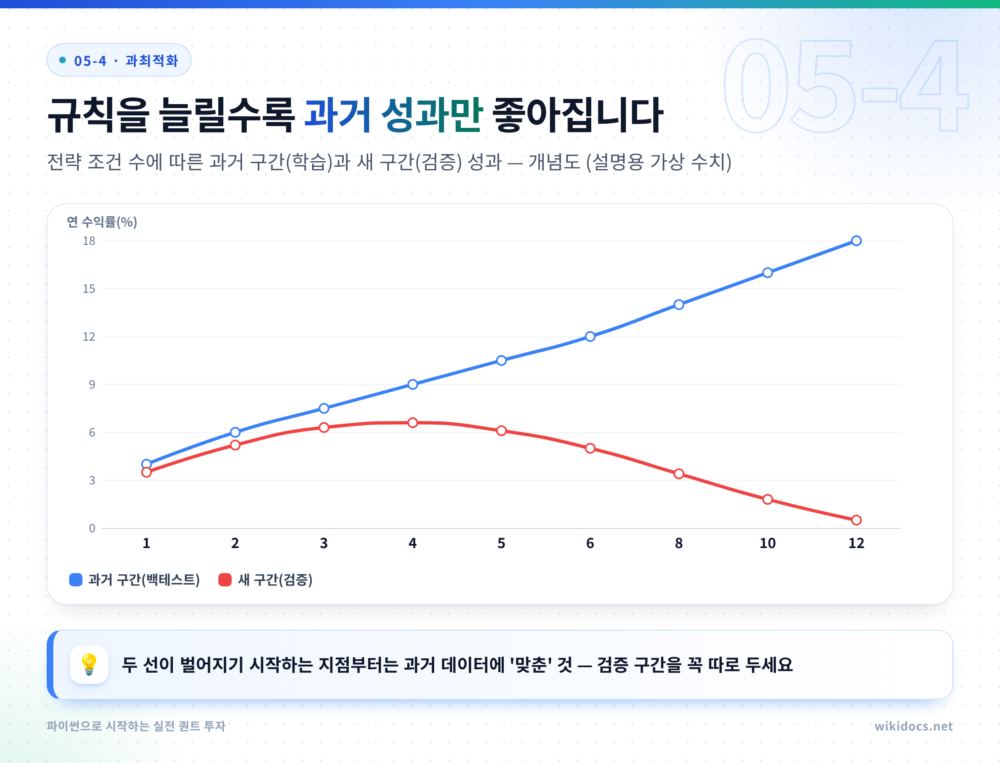

<!--
**상태**: 🟡 작성 중
**분류**: 05. 백테스트와 편향
**태그**: #백테스트 #검증
**작성일**: 2026-11-22
-->
> 📅 **최종 확인**: 2026-11-22

## 요약

- (핵심 내용 3줄 이내)

## 주요 내용

## 근거·출처

| 구분 | 출처 | 위치(조항/페이지/URL) | 비고 |
|---|---|---|---|
|  |  |  |  |

## 실무 체크포인트

- [ ] 

## 관련 페이지

- 05-1. 간단한 백테스트 엔진 만들기
- 05-2. 거래비용과 슬리피지
- 05-3. 생존편향·미래참조편향
