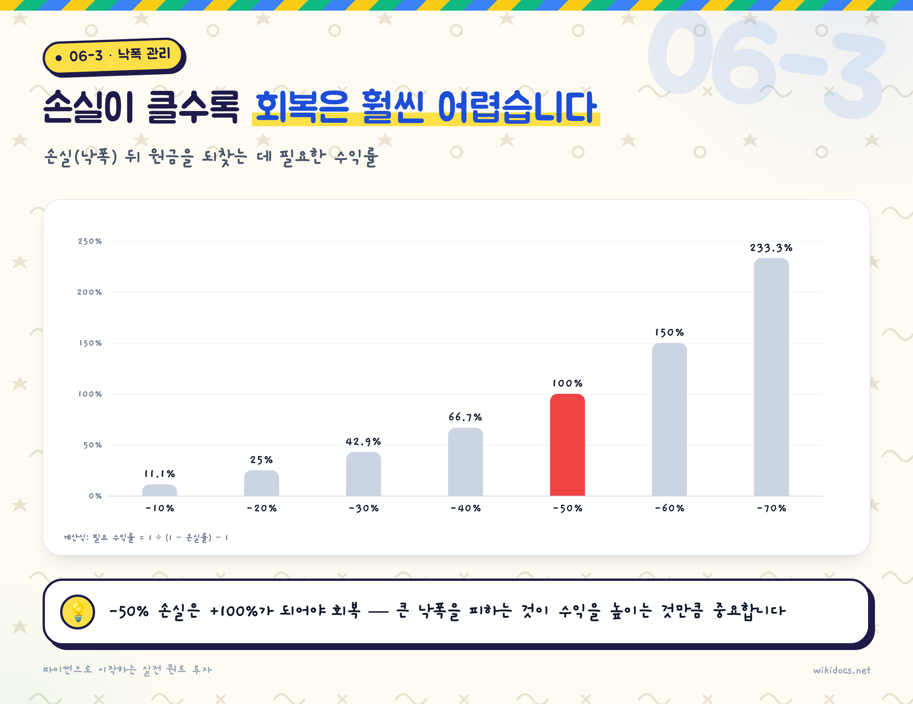

<!--
**상태**: 🔵 검토 중
**분류**: 06. 포트폴리오·리스크 관리
**태그**: #리스크
**작성일**: 2026-11-22
-->
> 📅 **최종 확인**: 2026-11-25

전략이 아무리 좋아도 큰 낙폭을 견디지 못하면 중간에 그만두게 됩니다. 이 페이지에서는 **포지션 크기를 위험에 맞춰 조절**해 낙폭을 줄이는 방법, 특히 **변동성 타기팅**을 다룹니다.

## 요약

- −50% 손실을 회복하려면 +100%가 필요합니다. 낙폭 관리는 수익만큼 중요합니다.
- **변동성 타기팅**: 최근 변동성이 크면 비중을 줄이고, 작으면 늘려 목표 변동성(예: 15%)을 맞춥니다.
- 가상 종목 C에서 MDD가 −84.5% → −47.2%로 줄었습니다(평균 투자비중 39.7%).



## 포지션 사이징 방법

| 방법 | 규칙 | 특징 |
|---|---|---|
| 고정 비율 | 한 번에 자산의 일정 % 위험만 감수 (예: 1회 손실 최대 1%) | 손절 폭과 함께 씀 |
| 변동성 타기팅 | 비중 = 목표 변동성 ÷ 최근 변동성 | 흔들릴 때 자동으로 줄임 |
| 낙폭 규칙 | 계좌 낙폭이 −10%, −20%면 비중을 단계적으로 축소 | 감정 대신 규칙으로 |

## 코드: 변동성 타기팅

전체 코드는 `code/16_position_sizing.py`에 있습니다.

```python
"""06-3. 낙폭 관리 — 변동성 타기팅(목표 변동성 15%)으로 위험 크기 조절"""
import numpy as np
import pandas as pd
from sample_data import make_prices

ret = make_prices()["C"].pct_change().dropna()
realized = ret.rolling(20).std() * np.sqrt(252)
weight = (0.15 / realized).clip(upper=1.0).shift(1).fillna(0)   # 최대 100%, 하루 늦게 적용
scaled = weight * ret

def s(r):
    eq = (1 + r).cumprod()
    return {"변동성": r.std() * np.sqrt(252), "MDD": (eq / eq.cummax() - 1).min(), "최종자산(시작=1)": eq.iloc[-1]}
print(pd.DataFrame({"그대로 보유": s(ret), "변동성 타기팅 15%": s(scaled)}).T.round(3))
print(f"\n평균 투자비중: {weight[20:].mean():.1%}")
```

## 실행 결과

```text
               변동성    MDD  최종자산(시작=1)
그대로 보유       0.393 -0.845       0.181
변동성 타기팅 15%  0.157 -0.472       0.652

평균 투자비중: 39.7%
```

## 해석

- 가상 종목 C는 크게 하락한 종목이라, 그대로 들고 있으면 자산이 0.181(−81.9%)이 됐습니다.
- 변동성 타기팅은 변동성을 목표(15%) 근처인 **15.7%**로 맞췄고, 최종 자산은 0.652로 손실이 훨씬 작았습니다.
- 다만 변동성 타기팅은 하락을 '막는' 것이 아니라 '줄이는' 것입니다. 이 예에서도 −47.2%의 낙폭이 있었습니다.

[[TIP("미리 정해 두기")]]

"계좌가 −20%가 되면 비중을 절반으로 줄인다"처럼 **낙폭 규칙을 미리 문서로** 정해 두세요. 손실 중에 내리는 결정은 대개 감정적입니다.

[[/TIP]]

> 모든 수치는 가상 데이터로 계산한 결과이며 투자 권유가 아닙니다. 과거 성과는 미래 수익을 보장하지 않습니다.

## 실무 체크포인트

- [ ] 감당할 수 있는 최대 낙폭을 숫자로 정했는가
- [ ] 변동성 계산에 미래 정보를 쓰지 않았는가 (하루 지연)
- [ ] 낙폭 단계별 대응 규칙을 문서로 남겼는가

## 관련 페이지

- 06-1. 비중 결정과 최적화
- 06-2. 리밸런싱
