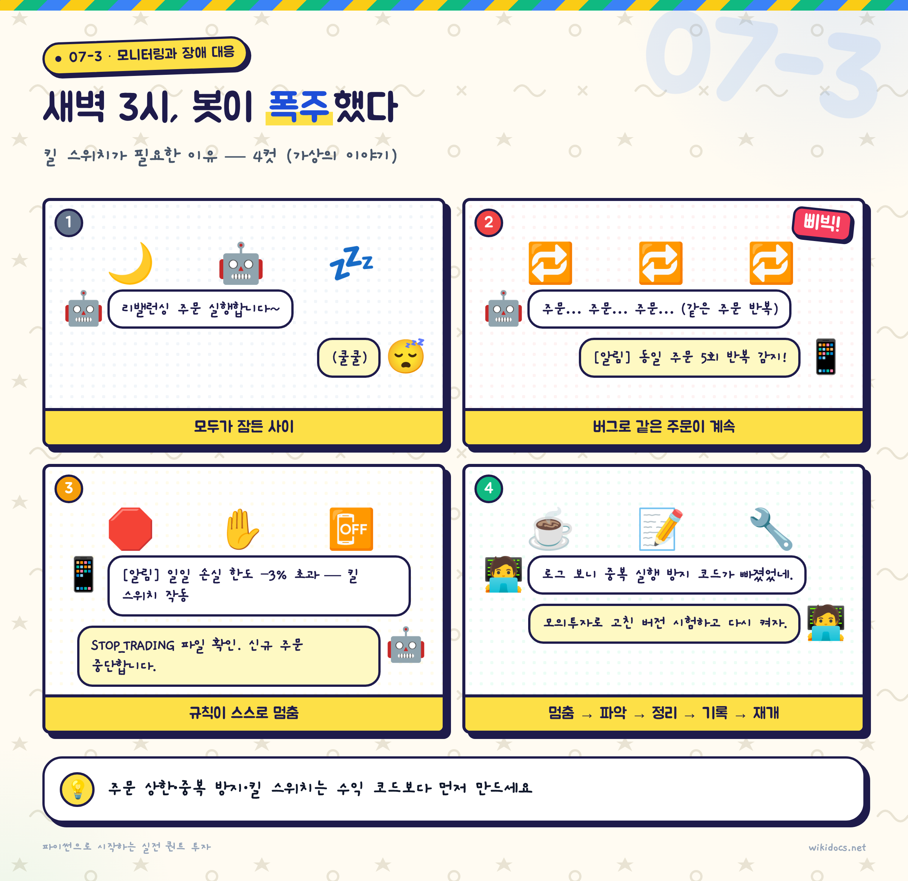

<!--
**상태**: 🔵 검토 중
**분류**: 07. 자동매매
**태그**: #자동매매 #운영
**작성일**: 2026-11-22
-->
> 📅 **최종 확인**: 2026-11-25

자동매매에서 가장 무서운 것은 **아무도 모르게 잘못된 주문이 계속 나가는 것**입니다. 이 페이지에서는 이상을 빨리 알아채는 모니터링과, 문제가 생겼을 때 즉시 멈추는 **킬 스위치**를 설계합니다.

## 요약

- 알림 기준을 미리 정합니다: 주문 실패, 데이터 이상, 예상과 다른 잔고, 일일 손실 한도 초과.
- **킬 스위치**: 파일 하나(또는 버튼)로 모든 신규 주문을 즉시 멈추게 합니다.
- 장애가 나면 **멈춤 → 원인 파악 → 수동 정리 → 재발 방지 기록** 순서로 대응합니다.



## 무엇을 감시하나

| 감시 항목 | 이상 신호 예 | 행동 |
|---|---|---|
| 데이터 | 오늘 데이터가 비었거나 가격이 ±30% 넘게 변함 | 매매 중단, 알림 |
| 주문 | 주문 거부, 같은 주문 반복 | 신규 주문 중단 |
| 잔고 | 목표 비중과 실제 비중 차이 큼 | 알림, 다음 날 보정 |
| 손실 | 일일 손실이 한도(예: −3%) 초과 | 킬 스위치 작동 |
| 프로그램 | 정해진 시간에 실행 기록이 없음 | 알림 |

## 킬 스위치 (예시)

```python
from pathlib import Path

KILL = Path("STOP_TRADING")            # 이 파일이 있으면 모든 신규 주문 중단

def guard():
    if KILL.exists():
        raise SystemExit("킬 스위치가 켜져 있습니다. 신규 주문을 하지 않습니다.")

def daily_loss_check(pnl_pct: float, limit: float = -0.03):
    if pnl_pct <= limit:
        KILL.touch()                    # 스스로 멈춤
        raise SystemExit(f"일일 손실 {pnl_pct:.1%} — 한도 초과로 중단")
```

## 장애 대응 순서

```text
① 멈춤      킬 스위치 켜기, 미체결 주문 취소
② 파악      로그에서 마지막 정상 시점과 첫 오류 찾기
③ 정리      잔고를 확인하고 필요하면 수동으로 정리
④ 기록      원인·피해·재발 방지책을 문서로 남김
⑤ 재개      모의투자에서 수정본을 시험한 뒤 다시 켬
```

[[TIP("로그는 자세히")]]

주문할 때마다 **시각, 종목, 수량, 가격, 이유(어떤 신호), 응답 결과**를 남기세요. 문제가 생겼을 때 로그가 없으면 원인을 찾을 수 없습니다.

[[/TIP]]

## 실무 체크포인트

- [ ] 알림 기준과 받을 사람(채널)을 정했는가
- [ ] 킬 스위치를 실제로 눌러 시험해 봤는가
- [ ] 주문마다 이유와 응답을 로그로 남기는가
- [ ] 장애 대응 순서를 문서로 만들었는가

## 관련 페이지

- 07-1. 증권사 API 연결
- 07-2. 주문 스케줄링
