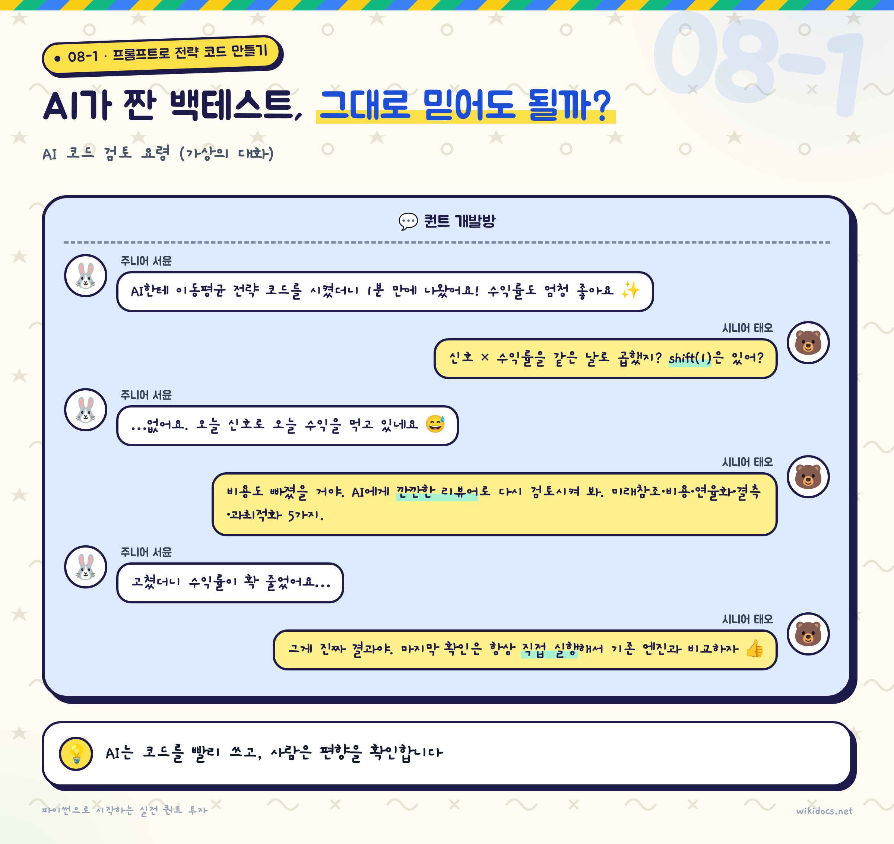

<!--
**상태**: 🔵 검토 중
**분류**: 08. AI 퀀트
**태그**: #AI
**작성일**: 2026-11-22
-->
> 📅 **최종 확인**: 2026-11-25

대화형 AI에게 "이런 전략을 코드로 짜 줘"라고 하면 몇 초 만에 백테스트 코드가 나옵니다. 하지만 AI가 만든 퀀트 코드에는 **미래참조·비용 누락** 같은 치명적인 실수가 자주 숨어 있습니다. 이 페이지에서는 AI로 코드를 만들고 **검증하는** 방법을 다룹니다.

## 요약

- 좋은 프롬프트에는 **데이터 모양, 규칙, 매매 시점, 비용, 출력 형식**이 들어가야 합니다.
- AI가 만든 코드는 반드시 **편향 체크리스트**로 검토합니다: shift(1), 비용, 생존편향, 검증 구간.
- AI에게 '스스로 검토'를 시키면 실수를 일부 찾아내지만, 최종 확인은 사람이 실행해서 합니다.



## 프롬프트 템플릿

```text
너는 파이썬 퀀트 개발자야.
[데이터] pandas DataFrame `prices` (인덱스: 영업일 날짜, 열: 종목코드, 값: 수정종가)
[규칙]   20일 이동평균이 60일 이동평균보다 크면 보유, 아니면 현금
[매매]   오늘 종가로 만든 신호는 '다음 거래일'부터 적용 (미래참조 금지)
[비용]   비중이 바뀔 때마다 편도 0.25% 차감
[출력]   함수 backtest(prices) → 일별 순수익률 Series, 그리고 CAGR·변동성·MDD 표
[제약]   numpy, pandas만 사용. 각 줄에 짧은 한국어 주석.
```

## AI가 자주 하는 실수와 확인법

| 실수 | 코드에서 보이는 모습 | 확인 질문 |
|---|---|---|
| 미래참조 | `signal * ret` (shift 없음) | "신호와 수익률 사이에 하루 지연이 있나?" |
| 비용 누락 | 비용 계산 줄이 없음 | "비중이 바뀔 때 비용을 빼나?" |
| 연율화 오류 | 월 데이터에 √252 사용 | "데이터 주기에 맞는 연율화인가?" |
| 결측 처리 | `dropna()`로 종목 전체를 날림 | "빈 값을 어떻게 처리했나?" |
| 과최적화 | 최고 파라미터를 찾아 그대로 보고 | "검증 구간이 따로 있나?" |

## 검토 프롬프트

```text
위 코드를 깐깐한 퀀트 리뷰어 입장에서 검토해 줘.
1) 미래참조편향 2) 비용 반영 3) 연율화 4) 결측 처리 5) 과최적화
각 항목을 '문제 없음 / 문제 있음(줄 번호와 이유)'으로 표로 답해 줘.
```

## 마지막 확인은 실행으로

1. 이 책의 엔진(05-1)과 **같은 데이터로 결과를 비교**합니다. 차이가 크면 이유를 찾습니다.
2. 신호를 하루 더 미뤄 봅니다(`shift(2)`). 결과가 크게 무너지면 타이밍에 지나치게 의존하는 전략입니다.
3. 결과가 너무 좋으면(샤프 3 이상) 먼저 버그를 의심합니다 (05-3).

[[TIP("AI 300% 활용법과 함께")]]

프롬프트 작성 요령은 시리즈의 「AI 300% 활용법」 04-6 코딩 레시피와 03-4 스스로 검토하게 하기를 참고하세요.

[[/TIP]]

## 실무 체크포인트

- [ ] 프롬프트에 매매 시점(다음 날 적용)과 비용을 명시했는가
- [ ] AI가 만든 코드를 편향 체크리스트로 검토했는가
- [ ] 같은 데이터로 기존 엔진과 결과를 비교했는가

## 관련 페이지

- 08-2. 뉴스·공시 LLM 분석
- 08-3. 머신러닝 팩터
- 📚 『AI 300% 활용법 — 코딩 레시피』
