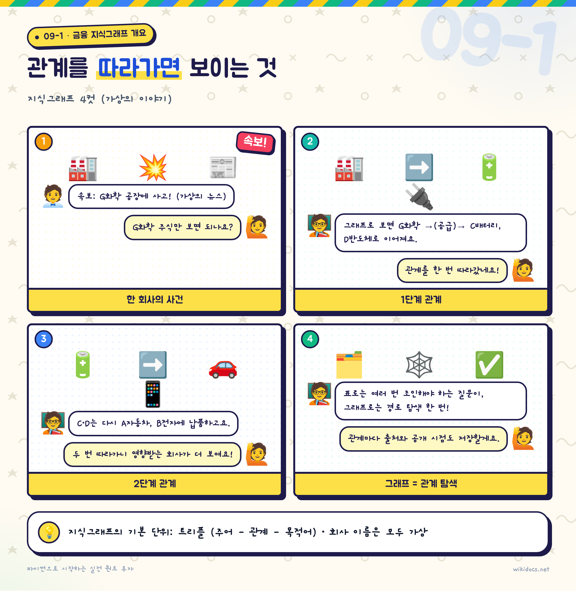

<!--
**상태**: 🔵 검토 중
**분류**: 09. 금융 지식그래프
**태그**: #지식그래프
**작성일**: 2026-11-22
-->
> 📅 **최종 확인**: 2026-11-25

**금융 지식그래프**는 기업·사람·산업·제품 사이의 관계를 **점과 선**으로 저장한 데이터입니다. "이 회사의 주요 고객사는 어디인가", "같은 대주주를 가진 회사는?" 같은 질문에 답할 수 있고, 관계를 따라 퍼지는 영향을 투자 아이디어로 연결할 수 있습니다.

## 요약

- 지식그래프의 기본 단위는 **트리플(주어-관계-목적어)**입니다. 예: (A자동차, 공급받는다, C배터리).
- 투자에 쓰는 관계: 공급망, 지분·대주주, 같은 산업, 경쟁, 임원 겸직 등.
- 관계 데이터도 **언제부터 알 수 있었는지(시점)**를 함께 저장해야 백테스트에 쓸 수 있습니다.



## 표 vs 그래프

| 질문 | 표(관계형 DB) | 그래프 |
|---|---|---|
| "A사의 PBR은?" | 쉬움 | 쉬움 |
| "A사 고객사의 고객사는?" | 여러 번 조인, 복잡 | 관계를 두 번 따라가면 끝 |
| "G화학 사고가 영향을 줄 종목은?" | 어려움 | 연결된 경로를 모두 탐색 |

## 금융 지식그래프의 구성 예

```text
(한빛전자) ─[공급받는다]→ (별빛반도체)        ← 사업보고서 '주요 매입처'
(한빛전자) ─[최대주주]→ (한빛홀딩스)          ← 공시 '최대주주 현황'
(한빛전자) ─[속한다]→ (반도체 산업)            ← 산업 분류
(별빛반도체) ─[경쟁한다]→ (달빛반도체)          ← 같은 제품군
* 회사 이름은 모두 가상의 예시입니다
```

## 데이터는 어디서

| 관계 | 출처 예 | 주의 |
|---|---|---|
| 공급·매출처 | 사업보고서의 주요 매출처·매입처 서술 | 이름이 공개되지 않는 경우가 많음, LLM으로 추출 후 검수 |
| 지분 | 공시(최대주주, 타법인 출자) | 정정 공시 반영 |
| 산업 | 거래소·통계청 산업 분류 | 분류가 바뀔 수 있음 |

[[TIP("LLM × 온톨로지와 함께")]]

관계를 어떻게 정의하고(온톨로지), LLM으로 문서에서 관계를 뽑는 방법은 시리즈의 「LLM × 온톨로지」 책에서 자세히 다룹니다.

[[/TIP]]

## 실무 체크포인트

- [ ] 관계의 종류와 의미를 먼저 정의했는가
- [ ] 관계마다 출처와 공개 시점을 저장하는가
- [ ] LLM으로 추출한 관계를 사람이 검수하는가

## 관련 페이지

- 09-2. 공급망 관계로 팩터 만들기
- 📚 『LLM × 온톨로지 — 지식그래프』
