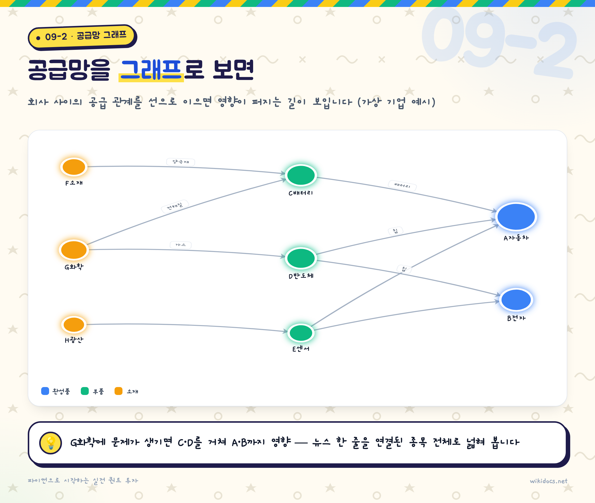

<!--
**상태**: 🔵 검토 중
**분류**: 09. 금융 지식그래프
**태그**: #지식그래프 #팩터
**작성일**: 2026-11-22
-->
> 📅 **최종 확인**: 2026-11-25

고객사에 좋은 소식이 있으면 부품을 납품하는 공급사에도 시간을 두고 영향이 갑니다. 하지만 투자자의 관심이 고객사에 몰려 있으면 공급사 주가에는 **늦게** 반영될 수 있습니다. 이 페이지에서는 공급망 관계로 **'고객사 모멘텀'** 점수를 만들어 검증하는 방법을 가상 데이터로 보여 줍니다.

## 요약

- 점수 = 공급사와 연결된 **고객사들의 지난달 평균 수익률**.
- 가상 데이터는 '고객사 수익의 30%가 한 달 늦게 공급사에 전해진다'고 **가정해서** 만들었습니다.
- 그래서 결과(플러스 97%)는 가정이 그대로 나타난 것입니다. 실제 시장에서는 효과가 훨씬 작고 불안정할 수 있습니다.



## 코드

전체 코드는 `code/18_supply_chain.py`에 있습니다.

```python
"""09-2. 공급망 관계로 팩터 만들기 — 고객사의 지난달 수익률이 공급사에 전해지는가 (가상 데이터)"""
import numpy as np
import pandas as pd

rng = np.random.default_rng(3)
months, n_cust, n_sup = 120, 30, 90
cust = rng.normal(0.006, 0.07, (months, n_cust))                 # 고객사(완성품) 월수익률
links = {s: rng.choice(n_cust, size=rng.integers(1, 4), replace=False) for s in range(n_sup)}
sup = np.zeros((months, n_sup))
for t in range(1, months):
    for s, cs in links.items():                                  # 가정: 고객사 지난달 수익의 30%가 늦게 반영
        sup[t, s] = 0.3 * cust[t - 1, cs].mean() + rng.normal(0.005, 0.06)

# 공급망 모멘텀 점수 = 연결된 고객사의 지난달 평균 수익률
spread = []
for t in range(1, months - 1):
    score = np.array([cust[t, links[s]].mean() for s in range(n_sup)])
    q = pd.qcut(score, 5, labels=False)
    spread.append(sup[t + 1, q == 4].mean() - sup[t + 1, q == 0].mean())
spread = np.array(spread)
print("공급사 예시 연결:", {f"공급사{s}": [f"고객사{c}" for c in links[s]] for s in range(3)})
print(f"상위-하위 월평균 차이: {spread.mean():.4f} · 플러스 달 비율: {(spread > 0).mean():.0%}")
own = np.array([pd.Series(sup[1:, s]).autocorr() for s in range(n_sup)])
print(f"참고) 공급사 자기 수익률의 1개월 자기상관 평균: {own.mean():.3f}")
```

## 실행 결과

```text
공급사 예시 연결: {'공급사0': ['고객사14'], '공급사1': ['고객사2', '고객사23', '고객사8'], '공급사2': ['고객사5', '고객사9', '고객사3']}
상위-하위 월평균 차이: 0.0455 · 플러스 달 비율: 97%
참고) 공급사 자기 수익률의 1개월 자기상관 평균: 0.010
```

## 해석

- 공급사 **자기 자신**의 지난달 수익률은 다음 달과 거의 관계가 없었지만(자기상관 0.010), **고객사**의 지난달 수익률은 공급사의 다음 달 수익률을 잘 구분했습니다(월평균 차이 4.55%).
- 이 차이는 가상 데이터에 넣은 가정(30% 지연 반영)에서 나온 것입니다. 이 예제는 방법을 보여 줄 뿐, 실제 효과의 크기를 말해 주지 않습니다.
- 학술 연구에서도 고객사 수익률이 공급사 수익률을 예측한다는 결과가 보고되었지만(아래 출처), 효과는 시장·기간에 따라 다릅니다. 실제 데이터로 다시 검증해야 합니다.

## 실제 데이터로 할 때

| 단계 | 할 일 |
|---|---|
| 관계 수집 | 사업보고서 주요 매출처 서술에서 고객사 추출 (LLM + 검수) |
| 시점 | 보고서 접수일 이후부터 그 관계를 사용 |
| 가중치 | 매출 비중을 알면 고객사 수익률을 비중으로 가중 평균 |
| 검증 | 03장과 같은 5분위 검증, 거래비용 차감 |

> 모든 수치는 가상 데이터로 계산한 결과이며 투자 권유가 아닙니다. 과거 성과는 미래 수익을 보장하지 않습니다.

## 실무 체크포인트

- [ ] 관계 데이터의 공개 시점을 반영했는가
- [ ] 가상 데이터의 가정과 실제 효과를 구분해 해석했는가
- [ ] 실제 데이터로 다시 검증했는가

## 근거·출처

| 구분 | 출처 | 비고 |
|---|---|---|
| 논문 | Cohen, L. & Frazzini, A. (2008). Economic Links and Predictable Returns. *Journal of Finance* | 고객사-공급사 수익률 전이 |

## 관련 페이지

- 09-1. 금융 지식그래프 개요
