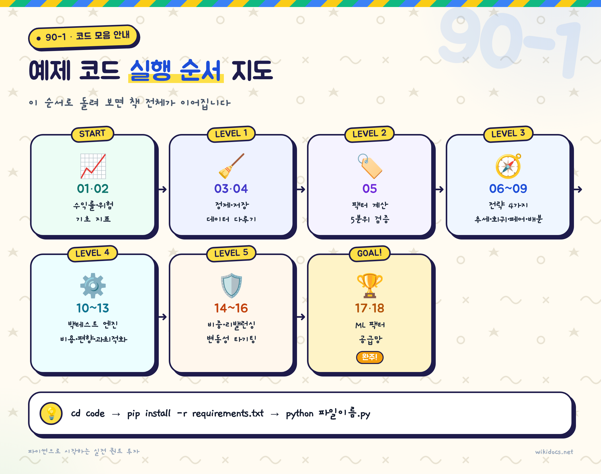

<!--
**상태**: 🔵 검토 중
**분류**: 90. 부록
**태그**: #부록 #코드
**작성일**: 2026-11-22
-->
> 📅 **최종 확인**: 2026-11-25

이 책의 예제 코드는 모두 `code/` 폴더에 있고, **numpy·pandas와 파이썬 표준 라이브러리만**으로 실행됩니다. 데이터는 `code/sample_data.py`의 가상 데이터를 쓰므로 인터넷 연결 없이 바로 돌려 볼 수 있습니다.

## 요약

- 설치: `pip install -r code/requirements.txt` 후 `cd code` → `python 05_factors.py`처럼 실행합니다.
- 각 페이지의 '실행 결과'는 `code/outputs/`에 저장된 **실제 실행 출력**과 같습니다.
- 실제 데이터로 바꾸려면 `make_prices()` 대신 같은 모양(날짜 × 종목)의 표를 넣으면 됩니다.



## 파일 목록

| 파일 | 내용 | 페이지 |
|---|---|---|
| sample_data.py | 가상 데이터: 주가(make_prices), 팩터용 종목(make_universe), 페어(make_pair), 자산(make_assets) | 전체 |
| 01_returns.py | 단순·로그·누적수익률, CAGR | 01-2 |
| 02_risk.py | 변동성, MDD, 샤프지수 | 01-3 |
| 03_cleaning.py | 결측치, 수정주가, 생존편향 | 02-4 |
| 04_storage.py | CSV·SQLite 저장 | 02-5 |
| 05_factors.py | 가치·모멘텀·퀄리티·저변동성·멀티팩터 계산과 5분위 검증 | 03장 |
| 06_trend.py | 이동평균 교차 | 04-1 |
| 07_mean_reversion.py | 볼린저밴드 평균회귀 | 04-2 |
| 08_pairs.py | 페어 트레이딩 | 04-3 |
| 09_allocation.py | 60/40·동일비중·변동성역가중 | 04-4 |
| 10_backtest_engine.py | 백테스트 엔진 (다른 예제에서 재사용) | 05-1 |
| 11_costs.py | 거래비용 민감도 | 05-2 |
| 12_biases.py | 미래참조편향 실험 | 05-3 |
| 13_overfitting.py | 과최적화 몬테카를로 실험 | 05-4 |
| 14_weighting.py | 비중 결정·위험기여 | 06-1 |
| 15_rebalance.py | 리밸런싱 방식 비교 | 06-2 |
| 16_position_sizing.py | 변동성 타기팅 | 06-3 |
| 17_ml_factor.py | 릿지 회귀 팩터 결합 | 08-3 |
| 18_supply_chain.py | 공급망 모멘텀 | 09-2 |

## 실행 방법

```bash
cd code
pip install -r requirements.txt
python 05_factors.py
```

[[TIP("결과가 책과 다르다면")]]

가상 데이터는 난수 씨앗(seed)을 고정했기 때문에 같은 라이브러리 버전에서는 같은 결과가 나옵니다. numpy·pandas 버전이 크게 다르면 숫자가 조금 달라질 수 있습니다. 이 책의 결과는 numpy 2.5, pandas 3.0에서 실행했습니다.

[[/TIP]]

## 실무 체크포인트

- [ ] requirements.txt로 라이브러리를 설치했는가
- [ ] code 폴더 안에서 실행했는가
- [ ] 실제 데이터로 바꿀 때 같은 표 모양을 맞췄는가

## 관련 페이지

- 90-2. 용어집
- 90-3. 참고자료
