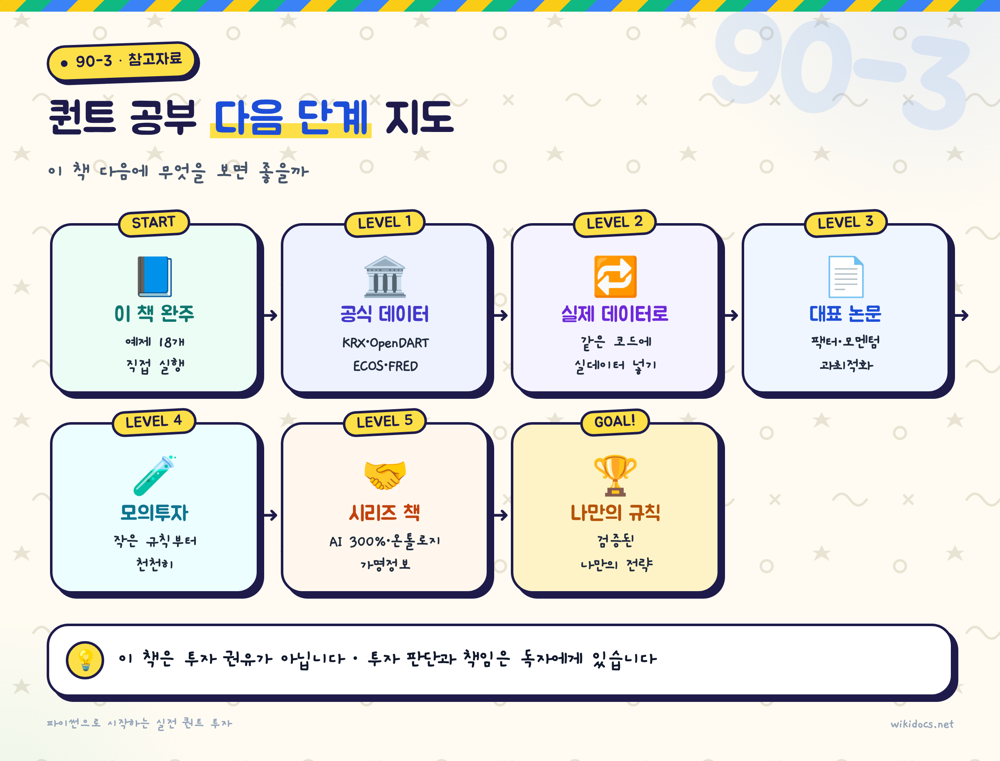

<!--
**상태**: 🔵 검토 중
**분류**: 90. 부록
**태그**: #부록
**작성일**: 2026-11-22
-->
> 📅 **최종 확인**: 2026-11-25

이 책을 쓰며 참고한 자료와, 더 공부할 때 도움이 되는 자료를 모았습니다. 데이터·제도는 자주 바뀌므로 **공식 사이트의 최신 안내**를 먼저 확인하세요.

## 요약

- 데이터·제도는 공식 사이트(거래소·감독원·국세청)를 1차 출처로 삼습니다.
- 팩터와 백테스트의 기초가 되는 대표 논문을 함께 실었습니다.
- 투자 판단과 책임은 독자에게 있으며, 이 책은 투자 권유가 아닙니다.

## 데이터·공식 사이트

| 구분 | 자료 | 내용 |
|---|---|---|
| 시세 | [한국거래소 정보데이터시스템](https://data.krx.co.kr) | 국내 시세·지수·상장폐지 현황 |
| 공시 | [금융감독원 OpenDART](https://opendart.fss.or.kr) | 공시·재무제표 API |
| 경제지표 | [한국은행 ECOS](https://ecos.bok.or.kr) | 금리·환율 |
| 경제지표 | [FRED](https://fred.stlouisfed.org) | 해외 경제지표 |
| 공공데이터 | [공공데이터포털](https://www.data.go.kr) | 금융위원회 시세 API 등 |

## 오픈소스 라이브러리

| 자료 | 내용 |
|---|---|
| [pykrx](https://github.com/sharebook-kr/pykrx) | KRX 데이터 수집 |
| [FinanceDataReader](https://github.com/FinanceData/FinanceDataReader) | 국내외 시세 수집 |
| [pandas](https://pandas.pydata.org) | 표 데이터 처리 |

## 논문

| 주제 | 자료 |
|---|---|
| 팩터 | Fama & French (1993), Common risk factors in the returns on stocks and bonds |
| 모멘텀 | Jegadeesh & Titman (1993), Returns to Buying Winners and Selling Losers |
| 모멘텀 붕괴 | Daniel & Moskowitz (2016), Momentum crashes |
| 수익성 | Novy-Marx (2013), The other side of value |
| 퀄리티 | Asness, Frazzini & Pedersen (2019), Quality minus junk |
| 저변동성 | Baker, Bradley & Wurgler (2011), Benchmarks as Limits to Arbitrage |
| 저변동성 | Frazzini & Pedersen (2014), Betting against beta |
| 과최적화 | Bailey, Borwein, López de Prado & Zhu (2014), Pseudo-Mathematics and Financial Charlatanism |
| 다중검정 | Harvey, Liu & Zhu (2016), …and the Cross-Section of Expected Returns |
| 머신러닝 | Gu, Kelly & Xiu (2020), Empirical Asset Pricing via Machine Learning |
| 공급망 | Cohen & Frazzini (2008), Economic Links and Predictable Returns |

## 시리즈의 다른 책

- 「AI 300% 활용법」 — 프롬프트와 AI 도구 (08-1과 연결)
- 「LLM × 온톨로지 무엇을 해야할까?」 — 지식그래프와 LLM (09장과 연결)
- 「가명정보 A to Z」 — 금융 데이터의 안전한 활용 (07-2 금융 사례와 연결)

## 실무 체크포인트

- [ ] 데이터·제도의 최신 내용을 공식 사이트에서 확인했는가

## 관련 페이지

- 90-1. 코드 모음 안내
- 90-2. 용어집
